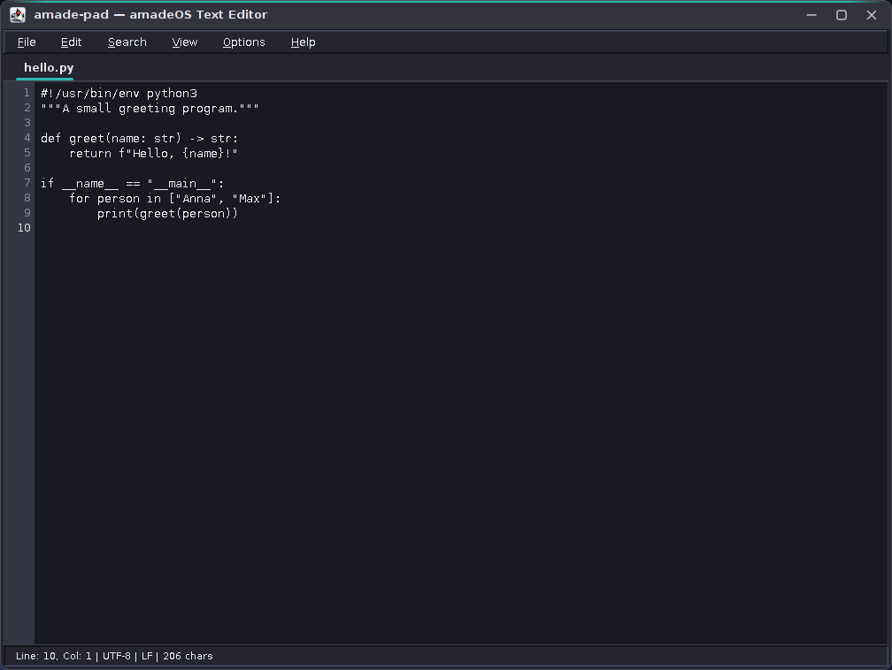
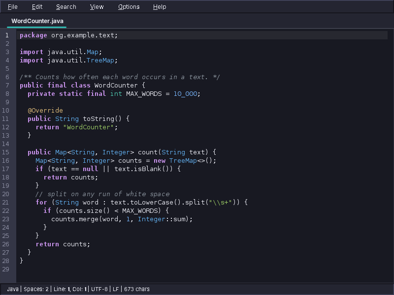

# amade-pad

**amade-pad** is an authentic Motif/CDE-styled text editor developed for the [amadeOS](https://github.com/amadeos-eu/amadeos) desktop environment.






---

## Features

- **Workstation Motif Aesthetic:** 3D chiseled bevels, recessed status panel and workstation menus in the colours of the current amadeOS desktop theme.
- **Tabbed Editing:** Multiple open documents with modified indicators (`*`) and safety prompts on close/exit.
- **Line Numbers & Margin:** High-visibility gutter rendering active line numbers, with fold markers for code blocks.
- **Syntax Highlighting:** About 35 languages (Java, Python, shell, C/C++, JavaScript/TypeScript, HTML, CSS, XML, JSON, YAML, Markdown, SQL, Makefile, Dockerfile, …) in colours that follow the light or dark desktop theme. The language is recognised from the file name, the extension or a `#!` first line; *View → Syntax* overrides it. Matching brackets are marked and blocks can be folded.
- **Indentation:** Two spaces per level by default; *Options → Indentation* chooses 2, 4 or 8 columns and spaces or tabs. A file that is already indented keeps its own indentation, Makefiles and Go use tabs, YAML never does. Enter keeps the indentation and adds a level after `{` or `:`, Tab and Shift+Tab indent selected lines, Backspace removes a whole level.
- **Format Document:** *Edit → Format Document* (`Ctrl+Shift+F`) indents JSON and XML anew; invalid files are left unchanged with the line of the error.
- **Find & Replace:** Non-modal search dialog with wrap-around and match-case support.
- **Encodings & Line Endings:** Detects UTF-8, UTF-16 (with BOM), Windows-1252 and ISO-8859-1 as well as LF, CRLF and CR line endings, and saves files back in the same format.
- **Integrated Undo / Redo:** Full document edit history (`Ctrl+Z`, `Ctrl+Y`).
- **Five Languages:** English, Deutsch, Français, Español and Italiano. amade-pad follows the amadeOS desktop language; *Options → Language* overrides it for amade-pad alone (takes effect at the next start). Outside amadeOS it uses `LANG`. Texts live in `src/main/resources/eu/amadeos/apps/pad/messages*.properties` (UTF-8); a test checks that every translation is complete.
- **Debian Packaging:** Direct creation of `.deb` packages installable via `dpkg -i` or drop-in `config/packages.chroot/` in amadeOS.
- **XDG Integration:** Ships Freedesktop-compliant `amade-pad.desktop` entry automatically picked up by CDE Front Panel drawers.

---

## Architecture

The Java 25 Swing application uses Guice for dependency injection. Theme, Motif look and start-up
come from [amade-commons](https://github.com/amadeos-eu/amade-commons): the editor follows the desktop
theme chosen in the Style Manager immediately, including the dark *Dark Slate*. `bootstrap`
wires `ui.main.MainWindow`, `MainMenuBar`, and `MainPresenter`; editor components
live in `ui.editor` and search controls in `ui.search`. `domain.DocumentState` tracks document identity and saved revisions.

`service.DocumentService` delegates persistence to `repository.DocumentRepository`
and its `repository.FileSystemDocumentRepository` implementation, which saves atomically.
`repository.TextCodec` detects the charset, byte order mark and line ending of a file;
the editor works with `\n` and `domain.TextFormat` restores the original format on save.
File operations run as `CompletableFuture` tasks on virtual threads; Swing access
and completion handling stay on the EDT through `ui.common.EdtExecutor`.
The text area is [RSyntaxTextArea](https://github.com/bobbylight/RSyntaxTextArea) (BSD 3-Clause):
`ui.editor.SyntaxColors` takes its colours from the desktop theme, `domain.SyntaxLanguage` recognises
the language of a file and `domain.Indentation` its indentation, and `service.format` re-indents JSON
and XML without changing a value. `repository.EditorSettings` keeps the default indentation in
`~/.config/amadeos/pad/editor.properties`.
`SearchService` contains the Swing-independent find/replace logic. SLF4J with
Logback reports failures, which are also displayed in the UI.

Closing waits for successful saves; cancellation or failure leaves the document
open. Edits made during a save remain dirty. Application exit disposes the windows
and shuts down the I/O executor without calling `System.exit`.

## Building and Testing

### Prerequisites
- Java 25+ JDK
- `amade-commons` is taken from JitPack; a checkout in `../amade-commons` is built instead if present
- (Optional) `dpkg-deb` for building `.deb` packages

### Run Unit Tests
```bash
./gradlew test
```

### Build Fat JAR
```bash
./gradlew jar
# Run directly:
java -jar build/libs/amade-pad-0.0.0-dev.0.jar
```

### Run with Gradle
```bash
./gradlew run
# Open files on startup:
./gradlew run --args="file1.txt file2.txt"
```

### Build Debian Package
```bash
./gradlew deb
# Package created at: build/distributions/amade-pad_0.0.0~dev.0_all.deb
```

### Install into amadeOS Live Build
```bash
./gradlew installToAmadeOs
# Copies the .deb into ../amadeos/config/packages.chroot/
```

---

## License

amade-pad is free software, licensed under the
[European Union Public Licence v. 1.2](LICENSE) (EUPL-1.2, SPDX identifier `EUPL-1.2`), like amadeOS
and the other amadeOS applications. Versions before this change were published under the MIT License.

Copyright &copy; 2026 datazuul.com and contributors.

amade-pad bundles RSyntaxTextArea, Copyright &copy; 2021 Robert Futrell, under the BSD 3-Clause
licence; its notice is in [packaging/licenses](packaging/licenses), in the jar and in the Debian
package's `copyright` file.
